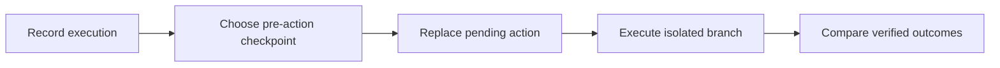

# Agent Time Machine

**Record an AI agent. Rewind a decision. Try another action. Verify the outcome.**

Agent Time Machine is a local debugger for developers building AI agents, created
for the Meta AI Developer Hackathon. A Meta model powers the live coding agent;
the debugger records its tools, files, observable conversation, and results.
Developers can restore a checkpoint, supply another action, execute an isolated
branch, and compare actual code changes and verification output.

The main demo uses a JavaScript timestamp parser. One deliberately injected patch
fixes a reported timestamp but breaks timezone offsets. Another weakens a test
to make its visible command pass without fixing the bug. Independent, frozen
checks reject both attempts. Failed branches remain beside successful repairs.

## Quick start

Validated with **Python 3.11 and Node.js 22 on Windows**. In PowerShell:

```powershell
git clone https://github.com/Eswar-deep/agent-time-machine.git
cd agent-time-machine
py -3.11 -m venv .venv
.\.venv\Scripts\python.exe -m pip install -r requirements.lock
npm ci
npm run build
.\.venv\Scripts\python.exe -m backend
```

Open **http://127.0.0.1:8000**. The deterministic demo needs no API key and makes
no model calls. The first startup saves a default coding run. Later launches
can use `./scripts/start.ps1` after building. See [setup](docs/SETUP.md) for
development mode, other platforms, configuration, and persistence.

## Try a repair

1. Choose **A fix that shifts time**, **Deterministic demo**, then **Run scenario**.
2. Select the `write_file` action and open **Intervene**.
3. In **Source content**, replace this complete line:

   ```javascript
   return new Date(local.getTime()).toISOString();
   ```

   with:

   ```javascript
   return new Date(local.getTime() - offsetMinutes * 60000).toISOString();
   ```

4. Keep **Deterministic demo policy** and click **Fork & execute**.
5. Inspect **Compare → Code changes**, **Test results**, and **Command output**.
   Accept the alternative only if its implemented checks pass. Its parent and
   other branches remain saved and unchanged.

The [demo walkthrough](docs/DEMO.md) also covers **The misleading green test**,
failed repairs, replay, and checkpoint inspection.

**Two test results serve different purposes.** A visible command can exit 0 after
its assertion is weakened; the final evaluation still rejects the repair.
An inherited failure before a successful edit remains historical evidence.
Final checks evaluate the resulting code.

## Live Meta mode

Copy [.env.example](.env.example) to a new `.env` without overwriting an existing
file. Configure `MODEL_API_KEY`, an accessible `META_MODEL`, and an explicit
`ATM_LIVE_MAX_CALLS` allowance, then restart the backend. The default allowance
is **0**. A full run can require several calls; the maximum is **12**.
Select **Live Meta** for a real coding-agent execution.

Live mode supports fresh continuation and reviewed model-generated patch
proposals. Keys stay on the server. Calls, failures, latency, and available token
usage are recorded. Monetary cost stays unknown unless pricing and usage are
available. There are no automatic retries or model-response caches.

One live date-parser repair was verified on **November 3, 2026**: **9 Meta calls,
8 tool calls, and 28/28 implemented checks passed**, without an injected patch.
That establishes one live fixture repair. Repeatable counterfactual recovery
demonstrations use injected failures and manual interventions.
See [validation evidence and limits](docs/VALIDATION.md).

## How it works



- **Checkpoint:** Candidate files, tracked/untracked metadata, conversation prefix,
  pending action, agent configuration, and compatibility hashes.
- **Isolation:** Candidate JavaScript runs in QuickJS WebAssembly with no exposed
  host filesystem, process, environment, network, or module loader. File tools
  modify only a virtual repository snapshot.
- **Verification:** Protected behavior expectations and test-integrity checks stay
  outside the guest and model prompts. Actual commands and exit codes are saved.
- **History:** SQLite stores immutable runs, checkpoint lineage, proposals, usage,
  and exports. Replay reexecutes tools; assistant messages remain recorded playback.
- **Interface:** Execution timeline, source editor with search/undo, state/context
  inspection, side-by-side evidence, saved history, themes, and responsive layout.

## Documentation

| Guide | Contents |
|---|---|
| [Setup](docs/SETUP.md) | Installation, configuration, development, persistence |
| [Demo](docs/DEMO.md) | Presentation steps, manual repairs, misleading tests, replay |
| [Architecture](docs/ARCHITECTURE.md) | Components, checkpoints, branches, model boundaries |
| [Coding sandbox](docs/CODING_SANDBOX.md) | Isolation implementation and security limits |
| [API](docs/API.md) | Endpoints, examples, execution and error semantics |
| [Validation](docs/VALIDATION.md) | Observed results, reproducible checks, supported claims |
| [Troubleshooting](docs/TROUBLESHOOTING.md) | Keys, billing, timeouts, checkpoints, test failures |
| [Progress](docs/PROGRESS.md) | Dated implementation history |
| [Third-party notices](THIRD_PARTY.md) | Runtime, editor, and vendored retail provenance |

## Development checks

```powershell
.\.venv\Scripts\python.exe -m pytest tests -q
npm run build
npm run test:ui
```

Latest recorded checks: **75 backend tests passed**, **11 browser tests passed**
against the real backend using Edge, and the production build passed. Browser
tests use deterministic scenarios and make no paid model calls. Playwright
reuses an existing server and creates test runs in its database; see
[validation](docs/VALIDATION.md) for separate test data.

## Scope

This supports a small synchronous JavaScript fixture and three secondary
synthetic retail scenarios using pinned tau2 tools. Arbitrary-repository shell
access, package installation, suspended OS processes, and external-service
rollback are outside the current scope. The app binds to loopback and has no
production authentication or deployment configuration.

The checks are public development assets, not a held-out benchmark. Passing them
does not establish universal correctness or a general recovery advantage.
The trusted launcher, verifier, and WASM runtime are part of the security boundary;
unknown runtime vulnerabilities are outside these claims. Earlier retail replay
evidence does not validate coding restoration. See the
[frozen fixture](fixtures/date_parser/README.md) and
[execution boundary](docs/CODING_SANDBOX.md).

