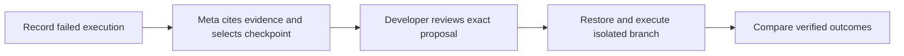

# Agent Time Machine

**Record an AI agent. Rewind a decision. Try another action. Verify the outcome.**

Agent Time Machine is a local debugger for developers building AI agents, created
for the Meta AI Developer Hackathon. A Meta model inspects a failed coding-agent
execution, cites the observed evidence, selects a checkpoint, and proposes a
targeted correction. The developer reviews that proposal; Time Machine restores
the checkpoint, executes an isolated branch with fresh continuation, and compares
actual patches and test results. The runner and protected evaluator decide
whether the repair passes the implemented checks.

The main demo uses a JavaScript timestamp parser. One deliberately injected patch
fixes a reported timestamp but breaks timezone offsets. Another weakens a test
to make its visible command pass without fixing the bug. Independent, frozen
checks reject both attempts. Failed branches remain beside successful repairs.

## Quick start

Validated with **Python 3.11 and Node.js 22 on Windows**. In PowerShell:

```powershell
git clone https://github.com/Eswar-deep/agent-time-machine.git
cd agent-time-machine
py -3.11 -m venv .venv
.\.venv\Scripts\python.exe -m pip install -r requirements.lock
npm ci
npm run build
.\.venv\Scripts\python.exe -m backend
```

Open **http://127.0.0.1:8000**. The deterministic demo needs no API key and makes
no model calls. The first startup saves a default coding run. Later launches
can use `./scripts/start.ps1` after building. See [setup](docs/SETUP.md) for
development mode, other platforms, configuration, and persistence.

## Main workflow: ask Meta to propose a repair

Configure the live allowance described below before this workflow. The original
can be a clearly labeled deterministic injection; proposal generation and
continuation make real Meta requests.

1. Choose **A fix that shifts time**, **Deterministic demo**, then **Run scenario**.
2. Inspect **Results → Code changes** and **Test results**. The injected edit
   accepts the reported timestamp but breaks timezone-offset behavior.
3. Click **Analyze with Meta**. The model receives public execution evidence and
   available checkpoint IDs, and selects its own supported intervention boundary.
4. In **Meta repair**, inspect **Candidate mistake**, **Observed evidence**,
   **Selected checkpoint**, and **Exact proposed action**. Protected acceptance
   definitions and expected answers stay outside the proposer prompt.
5. Click **Fork & execute proposal** to execute the unchanged reviewed action
   with fresh Meta continuation. Edited proposals are labeled manual instead.
6. Inspect **Compare → Code changes**, **Test results**, and **Command output**.
   Keep failed proposals and branches visible. A proposal marked ready has passed
   structural validation; only executed checks can establish a passing repair.

**Restart without advice** runs fresh Meta decisions from the same boundary
without the proposal or original future. Both use the declared call cap; the
repair branch's allowance includes its attached proposal. Compare observed
outcomes and all attempt costs without claiming general superiority.

## Offline manual repair

1. Choose **A fix that shifts time**, **Deterministic demo**, then **Run scenario**.
2. Select the `write_file` action and open **Intervene**.
3. In **Source content**, replace this complete line:

   ```javascript
   return new Date(local.getTime()).toISOString();
   ```

   with:

   ```javascript
   return new Date(local.getTime() - offsetMinutes * 60000).toISOString();
   ```

4. Keep **Deterministic demo policy** and click **Fork & execute**.
5. Inspect **Compare → Code changes**, **Test results**, and **Command output**.
   Accept the alternative only if its implemented checks pass. Its parent and
   other branches remain saved and unchanged.

The [demo walkthrough](docs/DEMO.md) also covers **The misleading green test**,
failed repairs, replay, and checkpoint inspection.

**Two test results serve different purposes.** A visible command can exit 0 after
its assertion is weakened; the final evaluation still rejects the repair.
An inherited failure before a successful edit remains historical evidence.
Final checks evaluate the resulting code.

## Live Meta mode

Copy [.env.example](.env.example) to a new `.env` without overwriting an existing
file. Configure `MODEL_API_KEY`, an accessible `META_MODEL`, and an explicit
`ATM_LIVE_MAX_CALLS` allowance, then restart the backend. The default allowance
is **0**. A full run can require several calls; the maximum is **12**.
Select **Live Meta** for a real original coding-agent execution, or keep the
injected original and use **Analyze with Meta** for the required live proposer.

The adapter uses **Meta Model API directly**, model **`muse-spark-1.3`**, through
**Chat Completions** at `https://api.meta.ai/v1/chat/completions`. Each request
records its actual model, provider, role, response model, configuration, latency
and available usage. The repair proposer and continuing coding agent are distinct
recorded roles even when they use the same model. Keys stay on the server.
Monetary cost stays unknown unless pricing and usage are available. There are no
automatic retries or model-response caches.

On **November 3, 2026**, a real Meta-generated proposal selected the checkpoint
before the injected offset mistake and executed unchanged with fresh Meta
continuation. The alternative passed **28/28**, compared with the injected
original's **25/28**. The advice arm used **3 calls and 23,834 measured tokens**,
including the proposal, and took **27.57 seconds including proposal overhead**.

A fresh restart without advice from the same checkpoint also passed **28/28**,
using **3 calls, 14,450 tokens and 15.31 seconds**. Both had a 12-call cap. This
curated example demonstrates an executable Meta proposal, not a quality advantage
over restarting; the advice arm used more tokens and total time. Cost is unknown.
The [redacted evidence package](evidence/meta-repair-2026-11-03/manifest.json)
links the actual model configuration, original, proposal, checkpoint, branch,
restart and rejected tamper case. See [validation and limits](docs/VALIDATION.md).

## How it works



- **Checkpoint:** Candidate file additions, edits, deletions, tracked/untracked
  metadata, conversation prefix, pending action, configuration, and compatibility
  hashes. This captures supported dirty state independently of Git commits.
- **Isolation:** Candidate JavaScript runs in QuickJS WebAssembly with no exposed
  host filesystem, process, environment, network, or module loader. File tools
  modify only a virtual repository snapshot.
- **Verification:** Protected behavior expectations and test-integrity checks stay
  outside the guest and model prompts. Actual commands and exit codes are saved.
- **History:** SQLite stores immutable runs, checkpoint lineage, ready/failed/
  insufficient-evidence proposals, usage, and exports. Replay reexecutes tools;
  assistant messages remain recorded playback.
- **Interface:** Execution timeline, source editor with search/undo, state/context
  inspection, side-by-side evidence, saved history, themes, and responsive layout.

## Documentation

| Guide | Contents |
|---|---|
| [Setup](docs/SETUP.md) | Installation, configuration, development, persistence |
| [Demo](docs/DEMO.md) | Presentation steps, manual repairs, misleading tests, replay |
| [Architecture](docs/ARCHITECTURE.md) | Components, checkpoints, branches, model boundaries |
| [Coding sandbox](docs/CODING_SANDBOX.md) | Isolation implementation and security limits |
| [API](docs/API.md) | Endpoints, examples, execution and error semantics |
| [Validation](docs/VALIDATION.md) | Observed results, reproducible checks, supported claims |
| [Troubleshooting](docs/TROUBLESHOOTING.md) | Keys, billing, timeouts, checkpoints, test failures |
| [Progress](docs/PROGRESS.md) | Dated implementation history |
| [Submission checklist](docs/SUBMISSION_CHECKLIST.md) | Organizer requirements and evidence preparation |
| [Submission summary](docs/SUBMISSION_SUMMARY.md) | Exact Meta role, observed results, technology and limits |
| [Actual Meta repair evidence](evidence/meta-repair-2026-11-03/README.md) | Request/response, executed branch, baseline, negative case and measured usage |
| [Three-minute video](docs/VIDEO_SCRIPT.md) | Completed MP4, actual narration and recorded-evidence labels |
| [Live evidence manifest](evidence/meta-repair-2026-11-03/manifest.json) | Recorded real-provider repair and restart measurements |
| [Third-party notices](THIRD_PARTY.md) | Runtime, editor, and vendored retail provenance |

## Development checks

```powershell
.\.venv\Scripts\python.exe -m pytest tests -q
npm run build
npm run test:ui
```

Latest recorded checks: **109 backend tests passed**, **13 browser journeys
passed** across the existing 11 and two new mocked-proposal journeys, and the
production build passed. Browser tests make no paid model calls; provider
responses in proposal journeys are mocked. Playwright
reuses an existing server and creates test runs in its database; see
[validation](docs/VALIDATION.md) for separate test data.

## Scope

This supports a small synchronous JavaScript fixture and three secondary
synthetic retail scenarios using pinned tau2 tools. Arbitrary-repository shell
access, package installation, suspended OS processes, and external-service
rollback are outside the current scope. The app binds to loopback and has no
production authentication or deployment configuration.

The checks are public development assets, not a held-out benchmark. Passing them
does not establish universal correctness or a general recovery advantage.
The trusted launcher, verifier, and WASM runtime are part of the security boundary;
unknown runtime vulnerabilities are outside these claims. Earlier retail replay
evidence does not validate coding restoration. See the
[frozen fixture](fixtures/date_parser/README.md) and
[execution boundary](docs/CODING_SANDBOX.md).

Original project code is available under the [MIT license](LICENSE). Third-party
components retain their own licenses and [notices](THIRD_PARTY.md).

