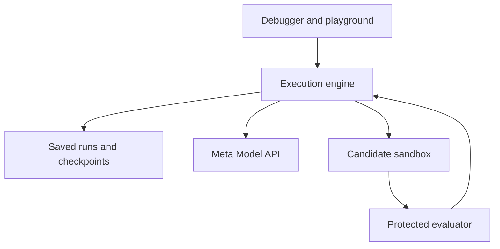

# Architecture

Agent Time Machine uses a React debugger, a local FastAPI service, and SQLite
for run history. The coding scenario operates on a virtual JavaScript repository.
The retail scenarios use a pinned subset of tau2 tools.

## Execution and storage

The [engine](../backend/engine.py) records tool calls and observations. The
[store](../backend/store.py) saves runs, checkpoints, and proposal records in
SQLite. Database triggers protect existing run records from updates and deletes.
Each branch stores the parent hash so the comparison can check its integrity.

A [checkpoint](../backend/checkpoints.py) captures the supported environment state,
conversation prefix, pending tool call, execution settings, and compatibility
fingerprints. Coding state includes tracked and untracked files, so checkpoints
can represent edits that have no Git commit. The engine validates the saved state
before restoring it.

A fork inherits the prefix up to the selected checkpoint. It applies a reviewed
model proposal or a manual action in a separate environment and records the
resulting execution. Original downstream events are excluded from fresh
continuation.

## Run modes

| Mode | Behavior |
| --- | --- |
| Deterministic demo | Scripted agent decisions with real sandbox tools and tests. The original coding demo injects a known regression. |
| Live Meta | Fresh tool decisions through the configured Meta model and call allowance. |
| Unchanged replay | Re-executes recorded tools and compares observations and final state. Saved assistant messages appear as playback. |

The Playground compares two original runs from the same parser fixture. The
debugger compares a fork with its parent. The [local API](API.md) also exposes a
supervised prompt experiment for comparing two live runs.

## Model and evaluation roles

The [model adapter](../backend/models.py) records provider, model, observable
responses, usage, and request timing. The [repair proposer](../backend/repairs.py)
receives the task and selected execution evidence. The engine validates its
checkpoint and proposed action before a developer can execute it.

The live agent produces the next tool action or final response. A separate
supervisor call reviews eligible edits and scores the rubric in the supervised
experiment API. The runtime enforces the experiment's file policy and shared
call allowance. [Supervisor implementation](../backend/playground.py)

The [protected verifier](../backend/coding_verify.py) evaluates candidate behavior
and visible-test integrity. It sends inputs to the guest and compares results
with expected values in trusted host code. The evaluator remains outside the
candidate snapshot and model inputs. [Coding sandbox](CODING_SANDBOX.md)

## Execution boundary

QuickJS WebAssembly executes the bundled synchronous JavaScript fixture.
The guest has a bounded runtime and no host filesystem, process, environment,
or network bridge. Source, policy, configuration, and runtime fingerprints
determine checkpoint compatibility. Arbitrary repositories, suspended OS processes,
and external-service rollback are outside the prototype's scope.
