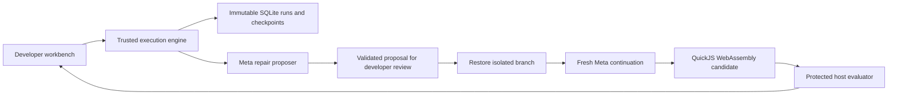

# Execution contracts

The primary workflow is one small coding repository with a frozen bug report and
acceptance contract. The earlier pre-authorized retail domain remains supported.
Both use one tool call per decision and record observable messages and results,
not hidden model reasoning.

The repair proposer generates a candidate intervention. The continuing coding
agent makes tool decisions in the changed branch. The runner executes tools, and
the protected evaluator judges checked behavior. Those roles remain distinct even
when proposer and continuing agent use the same Meta model.

## Components

- [domains](../backend/domains.py): small adapter dispatch retaining common
  recording, checkpoints, model calls, storage, lineage, and API contracts.
- [coding](../backend/coding.py): virtual file snapshots, tracked/untracked
  metadata, bounded file tools, scripted injected demo, and source differences.
- [coding runtime](../backend/coding_runtime.py): sanitized subprocess execution,
  hard watchdogs, runtime identity, and protected-verifier orchestration.
- [WASM launcher](../scripts/coding_sandbox.mjs): actual candidate execution in
  QuickJS, with no guest host-capability bridges.
- [protected verifier](../backend/coding_verify.py): frozen expected results and
  test-integrity checks outside candidate memory; emits real CLI results.

- [environment](../backend/environment.py): pinned tau2 retail adapter, strict
  tool allowlist/argument validation, snapshots, source compatibility.
- [agent](../backend/agent.py): explicitly scripted deterministic demonstration
  policy; computes fresh observations/messages after an intervention.
- [checkpoints](../backend/checkpoints.py): complete supported state at a
  pre-tool boundary, checksums, version/schema/runtime rejection.
- [engine](../backend/engine.py): run recording, immutable lineage, isolated
  forks, all-tool replay, proposals, comparison evidence.
- [store](../backend/store.py): SQLite transactions and append-only saved runs;
  checkpoints, model-call ledger, proposals.
- [models](../backend/models.py): opt-in bounded Meta requests, exact request
  identity, usage/error/latency ledger, no retries or response cache.
- [repairs](../backend/repairs.py): public-context projection, structured coding
  proposal schema, model-selected checkpoints, event references and strict
  action validation.
- [redaction](../backend/redaction.py): configured credential removal from
  observable model records and exported evidence.
- [evaluator](../backend/evaluator.py): independent, scoped outcome checks.
  Its expectations and code never enter candidate or proposer prompts.
- [API](../backend/api.py) and [interface](../src/App.tsx): local HTTP operations
  and an inspectable debugger workflow.

## Checkpoints and forks

Each tool checkpoint stores environment data, conversation prefix, pending
action, agent cursor/configuration, tool schemas, relevant source/policy hashes,
Python version, lineage, boundary, and whether local randomness is used.
Local randomness is unused; live provider sampling is not deterministic.

Coding checkpoints include all file contents, including relevant untracked
files, the frozen fixture identity, execution configuration, and runtime hashes.
Supported file additions, edits and deletions are captured by the full snapshot
map. A frozen baseline tracking index distinguishes tracked deletion from an
untracked path that was created and removed. `write_file` replaces or creates a
relative candidate file; `delete_file` removes a nonrequired one. The parser and
visible test file cannot be deleted. Paths and file/repository sizes are bounded.
This represents dirty candidate state without depending on a Git commit.
Live configuration includes model identity, reasoning effort, and execution
bounds. Observable progress text before a tool call belongs to that checkpoint's
conversation prefix; later messages are excluded from fresh continuation.
They are file snapshots, not suspended OS processes or general Git worktrees.
File-edit tools touch only that snapshot. Protected cases and example correction
patches remain outside the candidate file map and all model prompts.

The trusted verifier runs as a separate Python CLI. It sends only case inputs
and opaque IDs to fresh WASM guest contexts, receives primitive observations,
and compares them against host-held expectations. Candidate-visible tests run
separately and may be misleading; their source hash is checked independently.
Missing runtime, incomplete observations, timeouts, or verifier failure cannot
produce a passing task.

A fork validates the checkpoint before constructing a separate database object.
It inherits only events and conversation before the boundary. It replaces the
pending action with a declared manual or reviewed model patch, executes that
action, and runs a fresh continuation. Original downstream answers are not
substituted as new responses. Patch provenance and continuation type are stored.

The original and siblings are not updated. A parent's hash is saved when the
branch is created and checked again for the comparison view. Database triggers
prevent app-level updates/deletes of saved runs.

## Three distinct modes

1. **Recorded playback:** read saved events without execution.
2. **Unchanged tool replay:** execute every recorded tool in order, including
   reads and error-producing calls. Compare all observations and final state.
   Displayed assistant messages remain recorded; task success is not rescored.
   Coding replay excludes measured duration fields from equality checks but
   retains raw command output and compares code, exit statuses, and observations.
3. **Intervention:** restore pre-action state and execute a declared change plus
   fresh continuation. A successful intervention supports that change in this
   sandbox, not a unique causal diagnosis.

**Checkpoint restart without advice** is another fresh execution, separate from
replay. It restores the same boundary, discards the recorded pending action and
asks Meta for a new decision. It receives neither repair advice nor the original
future. Its record declares that provenance. Comparing it with an intervention
requires the same stated cap and disclosure that the proposer saw the full
original public trace.

## Grading boundary

State, final communication, basic authentication, exact upfront consent, and
execution completion are checked separately. Unrelated state must be preserved.
Full retail policy, natural-failure recovery, user-simulator replay, and
unrestricted environments are not supported claims.

The coding fixture and retail scenarios are development experiments. Deterministic
originals contain explicit injected faults; live original-agent runs and live
repair proposals are labeled separately. Coding has 25 frozen behavior cases
plus independent test integrity, visible-command, and execution-completion
checks. A manual result does not validate a live proposal. Real-provider evidence
and its current limits are recorded in [validation](VALIDATION.md). No held-out
live evaluation is reported. Broader evaluation must freeze separate tasks before
tuning and compare retry, restart and intervention under declared budgets and
information access.

## Model boundary

The continuing agent receives the public task, custom policy, allowed schemas,
and observations. Coding file tools access only the virtual candidate snapshot;
retail has no file tool. Neither domain exposes evaluator/gold-data access.
A separate coding repair proposer receives a strict public projection, rather
than a serialized saved run: original task, injected provenance, candidate initial
and final files, code changes, public execution events, development-test output,
compatible checkpoint IDs/pending actions and aggregate verification counts.
Protected definitions, expected answers, per-case verification diagnostics,
protected-evaluator error events and reference corrections are excluded. Thus
an exported run may contain more review evidence than any model prompt.

The proposer makes an actual JSON-output Meta request and returns `ready` or
`insufficient_evidence`, an existing checkpoint ID, unique observed event
references, explanation, expected improvement and one bounded tool action.
Unknown fields, missing required fields, invalid references, foreign checkpoints,
unsafe paths and unsupported actions are rejected before execution. Raw observable
responses, validation/API failures and insufficient-evidence decisions are saved
in proposal history. There is no silently substituted repair.

Proposals never execute until reviewed. An unchanged ready proposal must exactly
match its action/checkpoint and use fresh Meta continuation; an edited action is
manual. The branch's explicit intervention retains the proposer's explanation,
evidence and expanded trace-access provenance. Ordinary agent context is restored
only to the boundary, and original future responses are excluded.

The current adapter sends requests directly to Meta Model API Chat Completions
at `https://api.meta.ai/v1/chat/completions`; `muse-spark-1.3` is the configured
verified model. Other provider URLs are rejected. Each call records its actual
requested model, returned model, role, endpoint, generation configuration,
observable response and failure status. Configuration includes reasoning effort,
output-token limit, timeout and call allowance. It does not request private
reasoning text.

Each provider attempt is logged immediately, including failures and abandoned
proposals. Branch usage includes its attached proposal and fresh continuation,
excluding reused parent-prefix cost. The global ledger also retains unattached
and failed proposal calls. Actual usage may be unavailable; cost then stays
unknown. Calls/output/timeouts are bounded and retries disabled.
The hard maximum is 12 calls per branch/run, with a maximum 60-second request
timeout. Proposal attempts against an original also consume that original's
proposal allowance. Restart and intervention comparisons state their budgets;
all abandoned calls remain visible globally rather than disappearing from cost
accounting. A ready schema or model explanation never overrides actual checks.

Run exports carry the parent, selected fork checkpoint, attached and related
proposals, full run/checkpoint evidence and relevant model calls. Configured
credentials are redacted recursively. Redacted checkpoint contents may no longer
match original hashes; the export says so, without weakening restore validation.

## Limitations

There is no production authentication, deployment, concurrent background job
system, interactive user simulation, external rollback, arbitrary-repository
shell execution, complete retail policy verifier, live benchmark result, or
claimed novel invention of time travel.
DoVer and framework time-travel facilities overlap with this workflow, as the
handoff acknowledges; the unavailable validation report's source links have not
been inspected.

